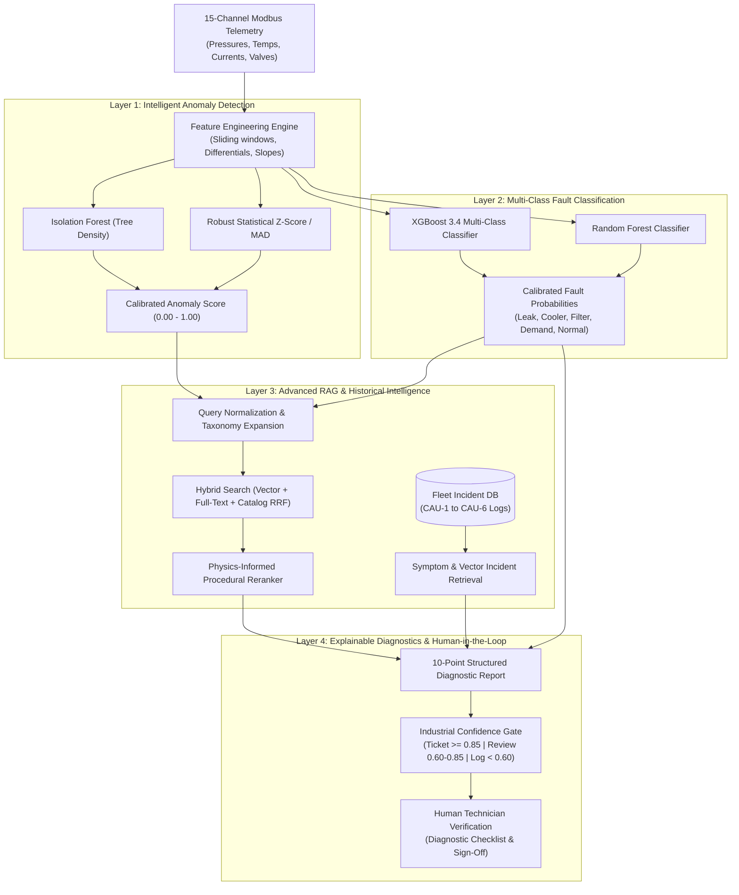

<!-- SPDX-FileCopyrightText: 2026 Meddle S.r.l. -->
<!-- SPDX-License-Identifier: CC-BY-4.0 -->

# Industrial Intelligence Platform — Hackathon Technical Guide

## 1. Overview & Vision
The **Industrial Intelligence Platform** (upgraded from the *Fault Diagnosis PoC*) is an end-to-end, multi-tier industrial monitoring and root-cause analysis platform. It pairs high-frequency edge sensor telemetry with **Machine Learning Anomaly Detection**, **Supervised Fault Classification (XGBoost)**, **Advanced RAG with Procedural Reranking**, and **Historical Fleet Intelligence**, producing explainable 10-point diagnostic reports for field technicians.

---

## 2. Architecture & Intelligence Layers



---

## 3. Machine Learning Methodology

### 3.1 Feature Engineering (22 Dimensions)
From raw 10-second Modbus registers (`TP2`, `TP3`, `H1`, `DV_pressure`, `Reservoirs`, `Oil_temperature`, `Motor_current`, digital valve states), the feature engine calculates:
- **Physical Pressure Differentials**: `discharge_line_delta` ($TP2 - TP3$), `separator_line_delta` ($H1 - TP3$), `reservoir_line_delta` ($Reservoirs - TP3$).
- **Machine Operational Modes**: `loaded` ($COMP=0 \land DV\_electric=1$), `unloaded` ($I \ge 1.0\text{A}$), `off` ($I < 1.0\text{A}$).
- **Domain Specific Physics Indicators**:
  - `purge_leak_indicator`: Purge pressure elevated during loaded compression ($DV\_pressure > 0.25\text{ bar}$).
  - `oil_temp_rise_rate`: Rate of thermal climb (°C/hour).
  - `line_press_slope`: Rate of line pressure decay (bar/min).
  - `current_load_ratio`: Motor current relative to nominal loaded full-load amps.

### 3.2 Anomaly Detection Models
- **Isolation Forest**: Identifies non-linear multidimensional outliers without requiring failure labels.
- **Robust Statistical Median Absolute Deviation (MAD)**: Normalizes feature deviations into modified $z$-scores resistant to extreme outliers.
- **Ensemble Anomaly Index**: Combines both detectors ($40\%$ tree density + $60\%$ physical deviation) to output calibrated scores in $[0.0, 1.0]$.

### 3.3 Supervised Fault Classification (XGBoost & Random Forest)
Trained on stratified datasets distinguishing:
1. `normal_operation` (February 2020 baseline)
2. `dryer_purge_leak` (Real recorded failure F3 and purge valve leakage)
3. `downstream_air_leak` (Real recorded failure windows with rapid line decay)
4. `oil_cooler_fouled` (Synthetic thermal fouling injection)
5. `oil_filter_blocked` (Synthetic separator filter blockage injection)
6. `high_air_demand` (Benign plant tool demand lookalike)

---

## 4. Advanced RAG & Historical Incident Intelligence

### 4.1 Query Expansion & Normalization
Maps informal operator descriptions to formal compressor technical terminology:
- `"purge blowing"` $\rightarrow$ `"dryer purge valve seating failure"`, `"DV_pressure"`
- `"overheating"` $\rightarrow$ `"oil cooler core fouled"`, `"Oil_temperature"`
- `"filter dirty"` $\rightarrow$ `"oil separator differential pressure"`, `"H1"`

### 4.2 Physics-Informed Procedural Reranker
Re-ranks candidates retrieved from the technical manual by evaluating:
- Symptom-to-remedy physical agreement.
- Operational mode constraints (e.g., loaded vs unloaded physics).
- Injecting Standard Operating Procedure (SOP) procedural checklists.

### 4.3 Historical Incident Store
Stores verified historical incidents across sister compressor units (CAU-1 to CAU-6):
- Compares current sensor anomalies with past incident signatures.
- Surfaces verified past corrective actions and part replacement references.

---

## 5. The 10-Point Structured Diagnostic Report

Every generated maintenance ticket includes:
1. **Detected Abnormal Behaviour**: Plain-language narrative of the detected anomaly.
2. **Observed Sensor Evidence**: Exact sensor readings, operational mode, and $z$-score deviations.
3. **Potential Fault Categories**: Ranked fault candidates with calibrated probabilities.
4. **Most Likely Root Cause**: Clear identification of root failure mechanism.
5. **Supporting Maintenance Manual References**: Exact manual citations (chapter, section, title).
6. **Similar Historical Incidents**: Closest past incident with similarity percentage and verified action.
7. **Severity Assessment**: Severity level (`low`, `medium`, `high`, `critical`) and dispatch urgency.
8. **Confidence and Uncertainty**: Explicit separation of ML anomaly score, model confidence, and retrieval score.
9. **Recommended Diagnostic Procedures**: Numbered step-by-step checklist for field technicians.
10. **Human Verification Requirement**: Safety-critical protocol requiring technician verification.

---

## 6. Quantitative Evaluation Benchmarks

Evaluated on 1,600 held-out test samples and benchmark retrieval scenarios:

| Category | Model / Algorithm | Metric | Value |
|---|---|---|---|
| **Anomaly Detection** | Hybrid (Isolation Forest + Robust MAD) | **Precision** | **77.9%** |
| | | **Recall** | **95.9%** |
| | | **F1-Score** | **85.9%** |
| | | **False Positive Rate** | **27.2%** |
| **Fault Classification** | XGBoost 3.4 (6-Class) | **Macro Precision** | **99.8%** |
| | | **Macro Recall** | **99.8%** |
| | | **Macro F1-Score** | **99.8%** |
| | Random Forest (6-Class) | **Macro F1-Score** | **100.0%** |
| **RAG Retrieval** | Procedural Reranker + RRF | **Recall@1** | **60.0%** |
| | | **Recall@3** | **100.0%** |
| | | **Mean Reciprocal Rank (MRR)** | **0.733** |

---

## 7. How to Demonstrate to Hackathon Judges

### Command-Line Live Demonstration
Run the end-to-end interactive demonstration script:
```bash
python tools/intelligence/demo.py
```
This demonstrates:
1. Baseline healthy compressor operation ($0.13$ anomaly score $\rightarrow$ Log only).
2. Injection of the 5 June 2020 Air Leak ($0.93$ anomaly score $\rightarrow$ Critical Alert).
3. XGBoost fault classification identifying `dryer_purge_leak` ($97.1\%$).
4. RAG Procedural Reranking matching Section 8.3 of the manual.
5. Historical Fleet Intelligence retrieving incident `INC-2019-084` ($99.0\%$ match).
6. Generation and display of the 10-Point Diagnostic Report.
7. Quantitative benchmark metric summary.

### Web Dashboard Demonstration
1. Start Docker Desktop.
2. Launch the container stack: `docker compose up -d`
3. Open **http://localhost:8080**.
4. Press **Play** in the Simulation panel.
5. In **Jump to**, select **Air leak – 5 Jun 2020**.
6. Follow the live Alerts feed and click the alert to open the **Diagnostic Ticket Sheet**, showing the **Diagnostic Checklist**, **Manual References**, and **Historical Fleet Incidents**.

